# ☁️ Awesome Desktop Cross-Browser Cloud ⚡

**A Curated Directory of Cloud Browser Grids, Parallel Test Infrastructure & Open-Source Testing Stacks**

  
  
  
  
  
  

*Empowering QA engineers, SDETs, and DevOps architects to navigate cloud browser infrastructure, distributed Selenium grids, and high-velocity Playwright/Cypress execution pipelines.*

---

## 📑 Table of Contents
- [🌐 Sector Overview & Market Dynamics](#-sector-overview--market-dynamics)
- [🏢 SaaS & Hosted Cloud Platforms](#-saas--hosted-cloud-platforms)
- [🚀 Open-Source GitHub Projects](#-open-source-github-projects)
- [🤝 How to Contribute](#-how-to-contribute)
- [💖 Support & Sponsorship](#-support--sponsorship)
- [📈 Star History](#-star-history)
- [⚠️ Disclaimer](#️-disclaimer)

---

## 🌐 Sector Overview & Market Dynamics

The global cross-browser and cloud testing market is valued at approximately **$1.7B to $2.8B** (projected to exceed $5B by 2032 with a 10–12% CAGR). The market exhibits a **moderately concentrated structure at the enterprise top tier**—where a handful of dominant providers (BrowserStack, Sauce Labs, SmartBear, and TestMu AI/LambdaTest) capture over 40% of enterprise testing spend—while maintaining a **broadly fragmented long-tail** of 150+ regional niche testing providers and open-source self-hosted solutions driven by diverse rendering engines, device combinations, and strict data sovereignty requirements.

---

## 🏢 SaaS & Hosted Cloud Platforms

Below is the comparative breakdown of leading commercial desktop cross-browser cloud vendors, ranked by **company size (estimated valuation / annual revenue)** in descending order:

| Product | Company Size (Valuation / Revenue) | Description | Starting Pricing | Free Tier / Free Trial Limits |
| :--- | :--- | :--- | :--- | :--- |
| **[BrowserStack](https://www.browserstack.com/)** 🚀 | **$4.0B Valuation** (~$230M ARR) | Global cloud grid providing 3,500+ real desktop browsers and operating systems with instant parallel automation. | **$99/month** (Automate Desktop, billed annually at $1,188/yr; $129/mo billed monthly; Live from $29/mo) | **No permanent free tier**; Free trial with **100 automation minutes** + **30 manual Live testing minutes** (up to 1 min per device/browser session) |
| **[BitBar (SmartBear)](https://smartbear.com/product/bitbar/)** 🌐 | **$2.0B Valuation** (SmartBear parent, ~$500M+ Revenue) | High-performance enterprise cross-browser and real device cloud for scalable Selenium, Appium, and Playwright suites. | **€45/month** (~$49/mo, Live plan billed annually); Unlimited Automated from €202/month (~$220/mo) | **14-day free trial** with access to real desktop browsers and mobile devices; free tier available for qualifying open-source projects |
| **[CrossBrowserTesting](https://smartbear.com/product/crossbrowsertesting/)** 🔄 | **$2.0B Valuation** (SmartBear parent, ~$500M+ Revenue) | Cloud testing platform with 1,500+ real desktop browsers, automated screenshots, and responsive layout comparisons. | **$104/month** (Standard plan billed annually) | **7-day free trial** with full live interactive and screenshot testing capabilities; no permanent free plan |
| **[Sauce Labs](https://saucelabs.com/)** ⚡ | **$500M Valuation** (~$90M ARR) | Pioneer enterprise continuous testing cloud featuring 3,000+ browser/OS combinations and AURA AI test orchestration. | **$149/month** (Virtual Device Cloud, billed annually at $1,788/yr; $199/mo billed monthly) | **28-day free trial** with **60 minutes** of automated and live testing time; no permanent free tier |
| **[TestMu AI (LambdaTest)](https://www.lambdatest.com/)** 🧠 | **$400M Valuation** (~$120M ARR) | Next-generation AI-augmented testing cloud supporting 3,000+ browser environments with KaneAI and HyperExecute. | **$15/month** (Live Interactive, billed annually at $180/yr; Automation Desktop from $79/mo billed annually) | **Lifetime Free Tier**: **100 automation minutes/month**, **300 HyperExecute minutes/month**, and 5 live sessions of 2 minutes each |
| **[Experitest (Digital.ai)](https://digital.ai/products/continuous-testing/)** 📱 | **$370M+ Funding** (Digital.ai parent, ~$140M Revenue) | Enterprise-grade continuous testing grid combining desktop browsers and mobile devices with ALM governance. | **$160/month** (Enterprise base starting estimate; full custom quotes for enterprise grids) | **14-day free trial** upon verified enterprise contact; no permanent free tier |
| **[TestingBot](https://testingbot.com/)** 🤖 | **$1M–$5M Estimate** (~$150K–$1M Revenue) | Highly reliable European and US cloud testing grid supporting Selenium, Cypress, Playwright, and Puppeteer. | **$20/month** (Live Interactive, billed annually; $50/mo for Automated testing billed annually) | **14-day free trial** with **100 automated testing minutes**; lifetime 100% free plan for approved open-source projects |
| **[Comparium](https://comparium.app/)** 🔍 | **Bootstrap / Electronic Team** (~$1M–$3M Revenue) | Visual regression testing suite featuring multi-mode side-by-side screenshot comparisons and live web testing. | **$15/user/month** (billed annually) | **Lifetime Free Plan** with 1,000 monthly screenshot credits and 2 simultaneous comparison jobs |
| **[Browserling](https://www.browserling.com/)** 💻 | **Indie Bootstrap** (~$500K–$600K Revenue) | Lightweight, zero-plugin HTML5 interactive cross-browser sandbox for rapid manual web cross-browser debugging. | **$19/month** (Developer Single User plan, unlimited session duration) | **Lifetime Free Sandbox**: Unlimited manual sessions restricted to **3–5 minutes per session** with basic browser queue |
| **[Moon by Aerokube (Cloud)](https://aerokube.com/moon/)** 🌙 | **Bootstrap Micro-SaaS** (~$200K–$500K Revenue) | Kubernetes-native containerized browser execution cluster hosted in Aerokube's managed European cloud. | **$5/month per parallel session** (metered flat rate per concurrent browser pod) | **Lifetime Free Evaluation Tier**: Up to **3 concurrent browser sessions** fully functional without payment |

---

## 🚀 Open-Source GitHub Projects

Explore the top self-hosted browser grids, test runners, and automation frameworks, sorted in **descending order by GitHub stargazers**:

| Repository | Stars | Ecosystem | Description |
| :--- | :--- | :--- | :--- |
| **[microsoft/playwright](https://github.com/microsoft/playwright)** 🎭 |  | Cross-Browser E2E | Fast, reliable cross-browser end-to-end testing framework for modern web apps with Chromium, Firefox, and WebKit support. |
| **[puppeteer/puppeteer](https://github.com/puppeteer/puppeteer)** 🎪 |  | Headless Chrome/CDP | Node.js library providing high-level API control over Chrome and Firefox over the Chrome DevTools Protocol (CDP) and WebDriver BiDi. |
| **[cypress-io/cypress](https://github.com/cypress-io/cypress)** 🌲 |  | Developer-Centric E2E | Fast, easy, and reliable testing for anything that runs in a browser with interactive time-travel debugging and real-time reloads. |
| **[SeleniumHQ/selenium](https://github.com/SeleniumHQ/selenium)** 🌐 |  | Distributed WebDriver | The foundational W3C WebDriver reference implementation and Selenium Grid 4 hub-and-node distributed execution framework. |
| **[appium/appium](https://github.com/appium/appium)** 📱 |  | Cross-Platform Automation | Cross-platform test automation tool for native, hybrid, and mobile web apps on iOS, Android, and desktop operating systems. |
| **[nightwatchjs/nightwatch](https://github.com/nightwatchjs/nightwatch)** 🦉 |  | Full-Stack E2E | Integrated Node.js end-to-end testing solution with built-in test runner, grid orchestration, and support for W3C WebDriver & CDP. |
| **[webdriverio/webdriverio](https://github.com/webdriverio/webdriverio)** ⚡ |  | Next-Gen Browser/Mobile | Next-gen browser and mobile automation test framework for Node.js, compatible with WebDriver, WebDriver BiDi, and Appium protocols. |
| **[SeleniumHQ/docker-selenium](https://github.com/SeleniumHQ/docker-selenium)** 🐳 |  | Containerized Grid | Official Docker images for Selenium Grid with standalone, hub, and Chrome/Firefox/Edge nodes for instant containerized clusters. |
| **[aerokube/selenoid](https://github.com/aerokube/selenoid)** 🧊 |  | Docker-per-Session Hub | High-efficiency Golang implementation of the Selenium hub launching isolated browser sessions inside ephemeral Docker containers. *(Archived)* |
| **[aerokube/moon](https://github.com/aerokube/moon)** 🌕 |  | Kubernetes Orchestrator | Kubernetes-native browser execution grid supporting dynamic on-demand pod scaling for Selenium, Playwright, Cypress, and Puppeteer. |
| **[WebSummoner/websummoner](https://github.com/WebSummoner/websummoner)** 🪄 |  | Go Ephemeral Hub | Lightweight Selenoid successor packaged as a ~10 MB Go binary with zero Java dependency, 10x lower memory overhead, and full Selenoid API parity. |

---

## 🤝 How to Contribute

Contributions are welcome! Please follow these quick steps:

1. 🍴 **Fork** this repository.
2. 🌿 **Create a new branch** (`git checkout -b feature/add-new-tool`).
3. 📝 **Add or update the tool** in `README.md` keeping the tables clean, factual, and alphabetical or properly ranked.
4. 🚀 **Submit a Pull Request** with a concise summary of the addition or price verification.

---

## 💖 Support & Sponsorship

If you find this curated directory helpful for evaluating testing infrastructure or architecting your cross-browser cloud, please consider:

- ⭐ **Starring** the repository on GitHub
- 🍴 **Forking** and sharing with colleagues, test engineering teams, and DevOps communities
- ☕ **Sponsoring the project** to help keep the benchmark data and pricing tiers fresh:  
  

---

## 📈 Star History

---

## ⚠️ Disclaimer

- This curated list is maintained for educational and architectural research purposes.
- All product names, logos, and brands are property of their respective owners.
- Cloud browser pricing and free-tier limits change frequently—always cross-check official provider pages prior to architectural commitments.

---

Made with ❤️ by <a href="https://github.com/ishandutta2007">Ishan Dutta</a> and the open-source QA engineering community.

